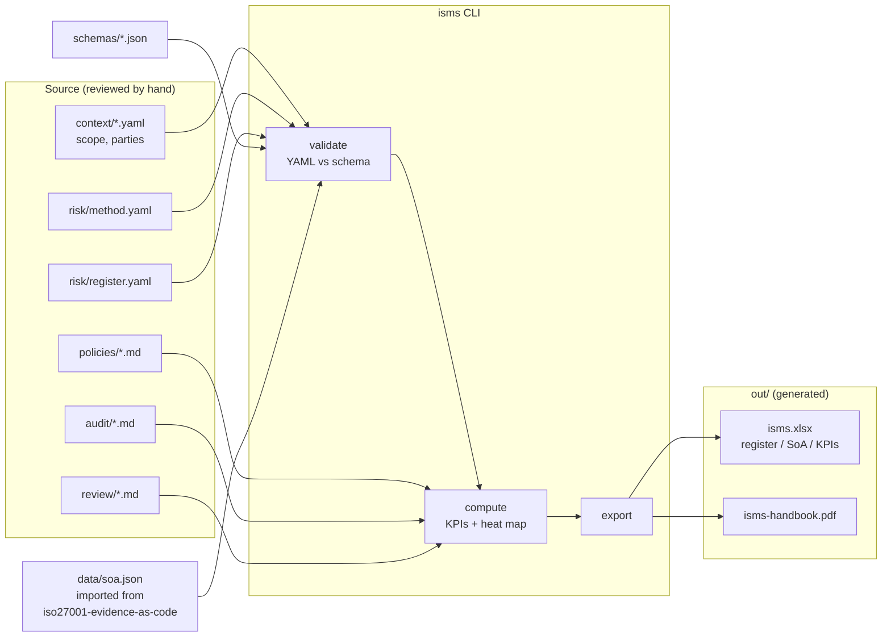

# Design — nordpay-isms

## 1. Overview

The repo is "ISMS-as-code": the ISMS artefacts (context, risk, policies, audit,
management review) live as **source** in Markdown and YAML, and a small Python CLI
(`isms`) turns the structured data into **validated generated outputs** (an Excel
workbook and a PDF handbook) under `out/`.

Design principles, straight from the steering rules:
- Source of truth is YAML/Markdown I can read and review; `out/` is disposable.
- No invented numbers: KPIs and the heat map are computed only from repo data, and a
  missing input becomes "not measured", never a guess.
- Nothing is "pass" without evidence: control status is imported from the companion
  repo's `soa.json` and never upgraded locally.
- Offline and free: pure-Python libraries, no network at build time.

## 2. Data flow (left to right)



## 3. Repository layout

```
nordpay-isms/
  context/            # cl.4 scope, interested parties, interfaces (YAML)
  risk/
    method.yaml       # cl.6.1.2 5x5 matrix + acceptance criteria
    register.yaml     # ~20 risks, linked to Annex A + DORA
  policies/           # 5 policies, EN + DE summary (Markdown)
  audit/              # cl.9.2 programme + one sample report (Markdown)
  review/             # cl.9.3 template + one worked quarter (Markdown)
  data/
    soa.json          # imported from iso27001-evidence-as-code
  schemas/            # JSON Schema for each YAML type
  src/isms/           # CLI package
    cli.py            # argparse entry: build / validate
    loader.py         # read YAML/JSON
    validate.py       # schema validation + cross-checks
    kpis.py           # KPI maths
    heatmap.py        # risk heat map counts
    soa.py            # SoA import + automation stats
    export_excel.py   # openpyxl workbook
    export_pdf.py     # fpdf2 handbook
  tests/              # pytest: validator + KPI/heatmap maths
  out/                # generated (gitignored)
  docs/spec/          # this spec (requirements / design / tasks)
  .github/workflows/  # CI
  pyproject.toml
  README.md
```

## 4. Data models (schemas)

Each YAML type gets a JSON Schema in `schemas/`. Key shapes:

### 4.1 context (cl. 4)
- `scope_statement`: string.
- `issues`: list of `{ type: internal|external, text, owner }`.
- `interested_parties`: list of `{ party, needs: [..], owner }`.
- `interfaces`: list of `{ name, direction, dependency, notes }` — includes the
  interface to `iso27001-evidence-as-code` and to Azure.
- Cross-check (R-4.3): every interested party needs >= 1 need and an owner.

### 4.2 risk method (cl. 6.1.2)
- `likelihood`: 5 bands `{ level: 1-5, label, meaning }`.
- `impact`: 5 bands `{ level: 1-5, label, meaning }`.
- `acceptance`: ordered bands `{ name, min_score, max_score, accept_role }`
  covering scores 1..25 without gaps.

### 4.3 risk register
- `risks[]`: `{ id, title, description, asset, threat, owner,
  inherent: {likelihood, impact}, treatment: {option, summary},
  residual: {likelihood, impact}, annex_a: [ids], dora: [articles?],
  acceptance: {decided_by?, date?, accepted: bool} }`.
- Scores (`inherent.score`, `residual.score`) are **computed** by the CLI as
  `likelihood * impact`, not stored, so they can't drift from the inputs.
- Cross-checks: `annex_a` IDs must exist in the SoA (R-RR.5); residual score above
  its acceptance band must have `acceptance.accepted: true` (R-RR.6).

### 4.4 SoA import
- `data/soa.json` is the companion repo's export: a list of 93 records with
  `id`, `title`, `status` (`manual` / `partial` / `pass` / `not-applicable`),
  `applicability`, `owner`, `evidence_ids`, `passing_rules`, `failing_rules`,
  `rules`, `theme`.
- A control counts as **automated** when it has rules/evidence ids; **passing** only
  when `status == pass`. The import never changes status (R-SOA.3).

## 5. CLI behaviour

`isms` is an `argparse` CLI installed via `pyproject.toml` console-scripts.

- `isms validate` — load + schema-validate every YAML, run cross-checks, print a
  summary. Non-zero exit on any failure. No artefacts written.
- `isms build` — run `validate` first; if it fails, stop with non-zero exit and
  write nothing (R-CLI.3). On success: import SoA, compute KPIs and heat map, write
  `out/isms.xlsx` and `out/isms-handbook.pdf`.

Order inside `build`: load -> validate -> compute -> export. Pure functions for
compute so tests can assert exact values.

## 6. KPIs (six, all computed)

| KPI | Formula (from repo data) | Missing-input behaviour |
|-----|--------------------------|-------------------------|
| SoA automation coverage | automated controls / applicable controls | "not measured" if SoA absent |
| Controls with evidence | controls with >=1 evidence id / applicable | "not measured" if SoA absent |
| Risks above acceptance (open) | residual-score risks over band without acceptance | "not measured" if register absent |
| Open audit findings | count of findings with status != closed | "not measured" if no audit data |
| CAPA on-time rate | CAPAs closed on/before due / closed CAPAs | "not measured" if no closed CAPA |
| Policy review currency | policies within review cadence / total policies | "not measured" if no policy metadata |

Audit findings, CAPA and policy metadata are kept as small YAML front-matter or a
companion `audit/findings.yaml` / `policies/index.yaml` so KPIs stay machine-readable
rather than parsed out of prose.

## 7. Heat map

`heatmap.py` returns a 5x5 grid: `grid[impact][likelihood] = count of risks`, using
residual likelihood/impact. The Excel "Risk register" sheet includes the grid; the
PDF handbook renders a compact version. Counts only — no colour claims beyond the
acceptance bands defined in the method.

## 8. Export

- **Excel** (`openpyxl`): sheets `Risk register`, `SoA`, `KPIs` (+ heat map block).
  Pure-Python, offline.
- **PDF** (`fpdf2`): a short handbook — scope, risk posture summary, SoA status
  counts, the six KPIs, and a line stating the data was generated from repo files on
  the build date. Pure-Python, offline. (If a value is "not measured", it prints that
  string.)

## 9. Validation strategy

- JSON Schema (`jsonschema` library) for structure.
- Python cross-checks for relationships schemas can't express: Annex A IDs resolving
  against the SoA, acceptance decisions present where required, interested-party
  completeness, acceptance bands covering 1..25 with no gaps/overlaps.

## 10. Testing

- `tests/test_validate.py`: one valid + one invalid fixture per schema; assert the
  invalid case fails with the expected error.
- `tests/test_kpis.py`: fixed small inputs -> assert exact KPI values, including the
  "not measured" path.
- `tests/test_heatmap.py`: fixed register -> assert exact grid counts.

## 11. CI

`.github/workflows/ci.yml`: on `pull_request`, set up Python, install the package,
run `isms validate`, run `pytest`, then `isms build`. Upload `out/` as a workflow
artefact. Never commit `out/`.

## 12. Dependencies (all pure-Python, offline-installable)

- `pyyaml`, `jsonschema`, `openpyxl`, `fpdf2`, `pytest`. No cloud SDKs, no network.
